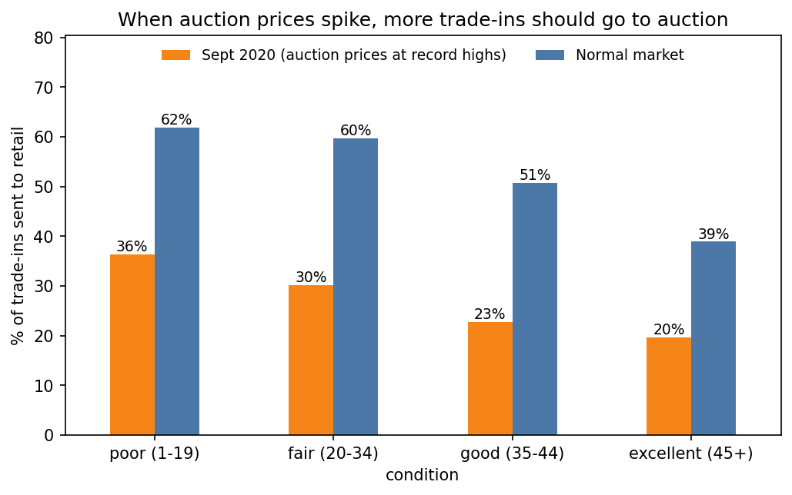
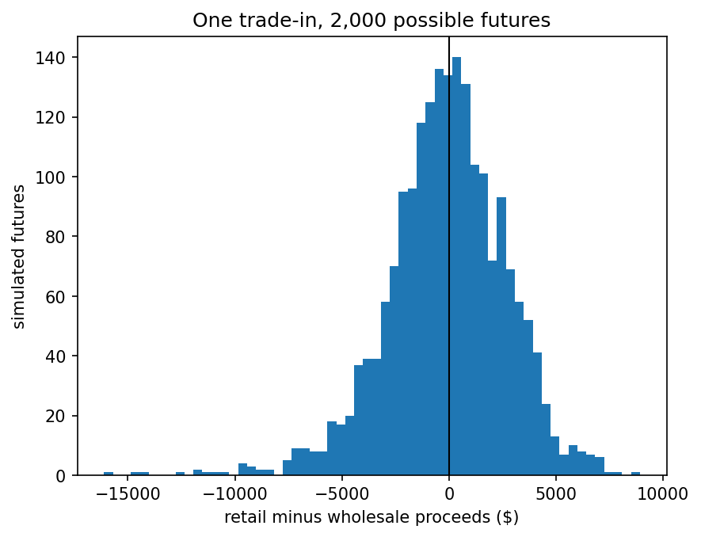
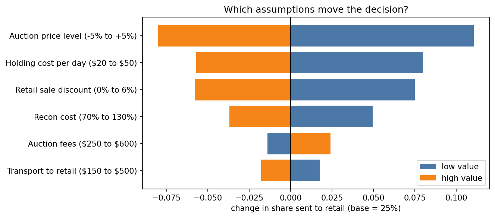
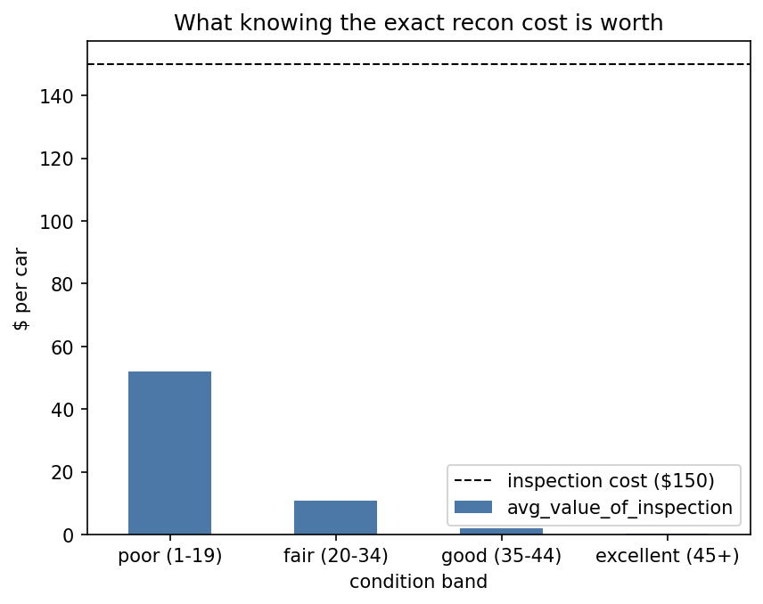

# Retail or Auction? A Decision Model for Used Car Trade-Ins

**[Try the live app](https://trade-in-decision.streamlit.app)**: move the market and cost sliders and watch 2,000 trade-in decisions update.

When a dealer takes in a used car, it has to choose: recondition it and sell it on the lot, or send it straight to auction. This project builds a model that makes that call car by car under uncertainty, measures which assumptions drive the decision, and estimates what an inspection is worth before deciding.

## The headline

**The best decision depends on the market.** In September 2020, when auction prices were at record highs and retail prices lagged, the model sends only **25%** of trade-ins to retail. In a normal market, where the gap between retail and auction prices matches the industry average, that share rises to **51%**.



| Key number | Value |
|---|---|
| Gain over the best simple rule ("always auction") | **$662 per car** |
| Share of the achievable value the model captures | **58%** (of $1,134 a perfect-hindsight rule could get) |
| Retail share: Sept 2020 market vs normal market | **25% vs 51%** |
| Typical time to sell, priced at market | **about 38 days** |

## How it works

**1. Bridge two datasets five years apart.** Auction sales come from 2014 to 2015; retail listings were scraped in September 2020. Auction prices are modeled as a ratio to the auction market's own value estimate (MMR) and converted to 2020 dollars with the Manheim Used Vehicle Value Index (124 to 161.2).

**2. Model three uncertain quantities, each as a range.**
- **Auction price:** quantile gradient boosting on 112k sales. 3.8% median error; 80% ranges hold in every condition band.
- **Retail price:** quantile gradient boosting on 280k listings. 7.6% median error.
- **Days to sell:** the listing data is a snapshot of cars still for sale, so no listing has a sale date. Time to sale is recovered with **stock sampling**: with a steady flow of new listings, the age mix of a snapshot traces out the survival curve. The method was validated on simulated data first (true shape 1.30, estimated 1.29).

Both price models were calibrated so their 80% ranges contain 80% of real outcomes. Overconfident ranges would make the simulation overconfident.

**3. Simulate and decide.** For 2,000 held-out trade-ins, simulate 2,000 possible futures each: auction price, retail price, reconditioning cost and days on the lot. Compare proceeds from each option and pick the one with higher expected value. Each decision comes with a confidence level and a bad-case (5th percentile) outcome.



*The closest call in the sample: a 2012 Ford Fusion where retail wins in exactly 50% of futures, yet outcomes range from about -$15,000 to +$9,000. The long left tail is futures where the car sits on the lot for months.*

**4. Stress test the decision.**



The auction price level matters most: a 5% swing moves the retail share from 36% to 17%. Holding cost per day and the retail sale discount come next. Auction fees and transport barely matter, so those placeholders don't need refining.

**5. Value of information.** An inspection that reveals the exact reconditioning cost is only worth paying for if it could change the decision. At $150, it clears that bar for just 18% of poor-condition cars and almost no others. Knowing *everything* in advance would be worth $440 to $600 per car, so uncertainty about prices and time on the lot matters far more than uncertainty about reconditioning.



## What I'd tell a dealer

1. **Watch the retail vs auction price gap, not just prices.** When auction prices spike faster than retail, more trade-ins should go to auction.
2. **Get holding cost right.** It is the second biggest driver; a dealer that turns cars faster should retail more.
3. **Don't inspect every car.** Target inspections at poor-condition cars near the decision line. Better market price data is worth more.

## A trap I avoided

The first time-to-sale model said overpriced cars sell *faster*. Checking listings by age showed why: new listings start about 1.6% above market and drift to 2.7% below after two months as dealers cut prices on cars that aren't selling. Sitting on the lot causes the low price, not the other way round. So the decision model uses baseline time to sale only and makes no pricing recommendations.

## Limitations

1. **Two datasets, different years.** Prices are bridged with ratios and the Manheim index, which adds uncertainty; this is why the market level is tested directly.
2. **An unusual market.** September 2020 followed three months of record auction prices. Results are shown for both that market and a normal-market scenario.
3. **Listing price is not sale price.** A 3% discount is applied, informed by the markdown pattern above.
4. **Stock sampling assumes a steady flow of new listings,** which COVID disrupted in 2020.
5. **The retail model can't see condition.** It treats every reconditioned car alike, while auctions pay a premium for clean cars. The pattern "better cars go to auction more" is an artifact of this, not a finding.
6. **Cost assumptions are placeholders** (reconditioning, holding, transport, fees), each tested in the sensitivity analysis.
7. **The wholesale model slightly overvalues poor-condition cars** (predicted 0.83 vs actual 0.81 of MMR).

## Run it yourself

```bash
python -m venv .venv && source .venv/bin/activate
pip install -r requirements.txt
```

Download the data from Kaggle into `data/raw/`:
- [US Used Cars Dataset](https://www.kaggle.com/datasets/ananaymital/us-used-cars-dataset): `used_cars_data.csv`
- [Vehicle Sales Data](https://www.kaggle.com/datasets/syedanwarafridi/vehicle-sales-data): `car_prices.csv`

```bash
python -m src.load_data               # clean both files into parquet
# then run the notebooks in order (VS Code or Jupyter, "# %%" cells):
#   notebooks/01_explore.py           what the data looks like
#   notebooks/02_models.py            price and time-to-sale models
#   notebooks/03_decision_engine.py   simulation, sensitivity, value of information
python -m src.export_app_inputs      # save the small input file the app reads
streamlit run app/streamlit_app.py    # interactive what-if app
```

The app reads only `app/app_inputs.npz` (about 150 KB of per-car price ranges and time-to-sale parameters), so the deployed version runs without the raw data or trained models.

## Repo structure

```
src/        config (every assumption in one place), loading, features, models, simulation
notebooks/  01 explore, 02 models, 03 decision engine
app/        Streamlit what-if app and its precomputed inputs
docs/       problem framing and week-by-week findings
reports/    figures and sensitivity table
```

## Sources

- Manheim Used Vehicle Value Index, September 2020 (161.2): [Cox Automotive](https://www.coxautoinc.com/insights-hub/wholesale-prices-cool-in-september-after-three-months-of-record-highs/)
- About $3,400 average spread between auction purchase and retail asking price, from 178k cars tracked by VIN: [Auto Remarketing](https://www.autoremarketing.com/?p=17763)

**Tools:** Python, pandas, scikit-learn (histogram gradient boosting, quantile loss), SciPy (custom maximum likelihood), NumPy Monte Carlo, Streamlit (deployed on Streamlit Community Cloud).
